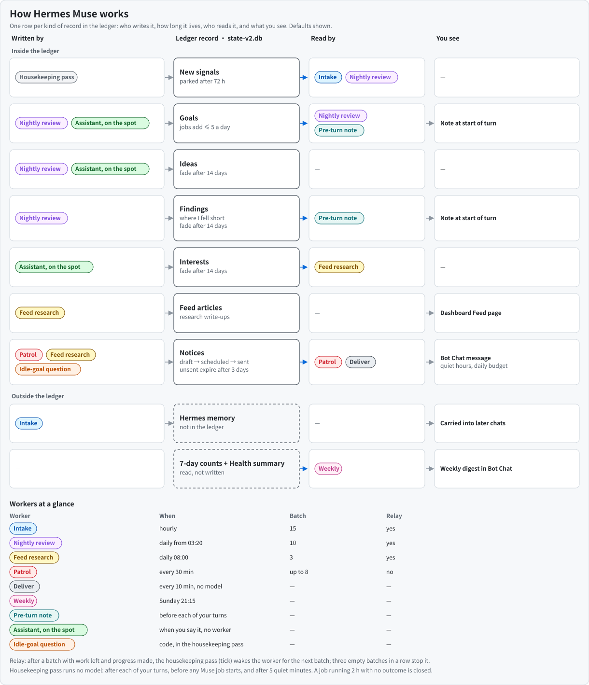

# Hermes Muse 0.4.6

[简体中文](README.zh-CN.md) · [Design](docs/DESIGN.md) · [Interface](skills/companion/references/interface.md) · [Acceptance](docs/ACCEPTANCE.md) · [Changelog](CHANGELOG.md)

An assistant that only answers when you speak leaves a lot undone: the trip you mentioned on Monday, the reply you were waiting for, the decision you said you would make by month-end. Hermes Muse is a plugin for [Hermes Agent](https://github.com/NousResearch/hermes-agent) that lets Hermes follow up on those things itself. It was inspired by the proactive interactions in [Meta's Muse](https://about.fb.com/news/2026/09/introducing-muse-personal-ai-agent/).

In practice it looks like this:

- You say you want to pick a bicycle by month-end. Muse keeps it as a goal, checks on it, and closes it only when you say you have decided.
- A reply you were waiting for arrives, or a meeting moves. The next patrol reads the original mail or event with your tools and tells you what happened and why it matters, once.
- "Done", "later" and "stop bringing this up" each do something different. When there is nothing worth saying, it stays quiet, keeps your quiet hours and never repeats the same notice.
- A goal you stopped talking about gets one question before it is closed, instead of being chased forever.

It is built on what Hermes already has: sessions, cron, delivery, delegation and native memory, with your existing model and memory provider. This is an independent project, unaffiliated with Meta/Muse; its code and prompts are independently written.

**Version 0.4.0 is Muse v2**: a deterministic kernel keeps the books (watermarks, dedupe, state machines, delivery), the model only judges and writes, and an independent Health check makes failures visible. Upgrading from 0.3.x is automatic; read [the upgrade notes](CHANGELOG.md) first.

## Plugin pages

Muse's Dashboard and Desktop page lets you choose a profile and browse its Feed, Ideas and Goals inside Hermes, with the last Health check on top. It is read-only and follows the host theme.


*Choose a profile, browse or search its Feed articles, and switch to Ideas or Goals. All screenshots use demo data.*


*Open a Feed article to read its Markdown-rendered text, with its sources listed below.*


*Ideas groups suggestions by the goal they relate to.*


*Goals lists open goals first, with status, next check and latest progress; done and cancelled goals are folded below.*

## Install

```sh
hermes plugins install xiaohei-info/hermes-muse --enable
```

Installation uses the selected profile (`hermes -p <profile> plugins install …`); each enabled profile has its own state, jobs and delivery. If you maintain explicit `platform_toolsets` lists, include `muse` where you use the plugin.

Requires Hermes 0.21.5 or later with the plugin APIs for tools, Skills, prompt sections and hooks; tested on Hermes 0.22.5 ([baseline](docs/ACCEPTANCE.md)). First load registers one Skill, two tools (`muse_manage`, `muse_job`), four hooks and one system prompt section, creates five recurring jobs and the `muse-health` check, and adds missing content files from `templates/` without overwriting anything. Start a new conversation to load the prompt section; background work needs a running scheduler and an available model, at their normal cost.

### Requirements

- Hermes Agent 0.21.5 or later (`requires_hermes: ">=0.21.5"` in `plugin.yaml`). Hermes itself needs Python 3.14.
- Tested on Hermes 0.22.5 only: CI pins that release and runs the full acceptance set against it.
- On another version Muse does not check the version number. Three core capabilities (prompt sections, plugin skills, unload hooks) are hard requirements: without them Muse refuses to load with a clear error. Other capabilities are checked by host probes; a missing one only degrades that feature and shows a high item in Health. After upgrading Hermes, run `tests/native_host_contract.py` ([details](docs/ACCEPTANCE.md)).

**Upgrading from 0.3.x** (0.3.1 from the catalog or any later 0.3 release): the first load migrates `muse/state.db` into `muse/state-v2.db` and refreshes the jobs in place, keeping their ids, schedules, routes and pauses. Rewrite personal cron prompts or scripts that call removed actions first ([caller migration](docs/CALLER-MIGRATION.md)), and follow [cutover and rollback](docs/CUTOVER.md) to go step by step or back to 0.3.x.

## How it works

Workers write what they find into Muse's ledger (`state-v2.db`); a few readers hand it back to you as a note, a message or a Dashboard page. The diagram shows the defaults.



| Job (cron key) | Default schedule | What the model does | Delivery |
|---|---|---|---|
| intake (`memory-upkeep`) | hourly, in batches until done | decides what each new private message means and which goal it touches | local |
| patrol (`proactive-watch`) | every 30 min | reads your sources with your tools, judges what is worth a notice and writes it | your route |
| nightly (`nightly-review`) | 03:20 | assesses every due goal, judges every review candidate, writes dream and alignment | local |
| feed (`feed-pulse`) | 08:00 | researches each active interest once a day, writes Feed articles, may raise one notice for real news | silent; a notice goes through the notice gates |
| weekly (`weekly-governance-review`) | Sunday 21:15 | one digest from the Health summary and 7-day counts | your route |
| deliver (`deliver`) | every 10 min | nothing: no model. Sends the notices that are due as one message (urgent ones wake it at once) | your route |

Each job's launcher first runs the kernel and builds a bounded packet; intake, nightly and feed leave the model asleep when their packet is empty, nightly and feed work through their queue in batches and Muse wakes them again until it is done, while patrol wakes every period because only the model can read your sources. Code captures messages, derives every id and key, dedupes notices against 7 days of history, applies quiet hours and budgets, delivers, reads delivery receipts, moves next checks, and asks about and closes dormant goals. The model returns only references, enum values and text. Behavior lives in `prompts/jobs/<job>.md`; fields in the generated [interface](skills/companion/references/interface.md). See the [design](docs/DESIGN.md) and [feature coverage](docs/FEATURE-COVERAGE.md).

Only private conversations on user surfaces (CLI, TUI, desktop, phone and messaging DMs listed in `USER_SOURCES`) are read and can change Muse state. Cron runs, delegated children, group chats and unclassified sources cannot.

## Data sources

Muse has no connectors. The patrol reads mail, calendars, reminders and the web only through tools your Hermes already has: Hermes built-ins first (`web_search`/`web_extract`, `google-workspace`, `himalaya`, `apple-reminders`, `imessage`, `apple-notes`), then [Apple PIM](skills/companion/references/source-apple-pim.md), then your own sources recorded in the profile's `muse/TOOLS.md` ([sources](skills/companion/references/sources.md)). Each check is recorded per source with its minimum interval; a source that is not connected or keeps failing shows up in Health. After installing, verify each source with the [source verification](skills/companion/references/source-verification.md) procedure.

## Preferences

Ask in chat, or edit `muse/PROACTIVE_PREFERENCES.md`. Fields: `start_hour`/`end_hour` (quiet hours outside them, default 9–22), `ordinary_per_day` (default unlimited), `time_sensitive_per_day` (default 3), `urgent_per_day` (urgent notices that may skip quiet hours, default 2; more are gated as time-sensitive), `blocked_topics`, `deliver` (route of the `muse-deliver` job that sends notices, default this profile's Bot Chat; a change applies from its next run, `null` keeps the job's route), `goal_dormant_days` and `goal_fade_days` (default 7 each; `null` turns them off), `fade_question` and `weather_context` (off by default; it uses a location you gave). Invalid preferences stop delivery with an error instead of guessing.

## Hermes configuration

Settings in the profile's Hermes `config.yaml` that Muse reads or depends on. Quiet hours, budgets, `blocked_topics` and the notice route live in Muse's own `muse/PROACTIVE_PREFERENCES.md` (see Preferences), not here.

| Setting | Recommended value | Why / what breaks otherwise |
|---|---|---|
| `plugins.enabled` contains `hermes-muse` (and not in `plugins.disabled`) | enabled | Every Muse job launcher checks this first; when disabled, or when the config cannot be read, all jobs stay silent. |
| `plugins.entries.hermes-muse.settings` | the place for Muse plugin settings | Read first, over `.config` and the legacy `plugins.hermes-muse`. If the legacy block exists, Health reports `probe.config_location` degraded until you move it. |
| ↳ `deliver` | unset (falls back to this profile's Bot Chat) | Route for `muse-deliver` (notices), patrol/weekly/watch jobs and `muse-health`, used when `deliver` is not set in preferences. Jobs take the route when they are created; later refreshes keep the job's existing route. |
| ↳ `health_deliver` | optional second route | Added to the `muse-health` job's route at install, so Health alerts are also sent here when the alert set changes. Without it they appear only in the main session, on the Muse page and in the cron output. Removing the setting later does not remove the route; edit the job's delivery then. |
| ↳ `source_intervals` | unset (built-in: mail 30 min, calendar 2 h, reminders 1 h, web/rss 6 h) | `{source id or kind: minutes}`; how often the patrol re-checks a source. Shorter intervals cost more model time. |
| `platform_toolsets` (only if you maintain explicit lists) | include `muse` | The `muse_manage`/`muse_job` tools are registered in toolset `muse`. A list that omits it hides them, so jobs cannot submit and chat cannot manage goals. |
| `timezone` (or `HERMES_TIMEZONE`) | your IANA zone | Quiet hours, daily budgets, the daily goal-creation cap and the default job schedules use Hermes' profile time. Without it Muse uses server-local time. |
| `memory.write_approval` | `false` (default) | With `true`, every memory write in a cron session, adds included, is staged for approval because nobody can answer. The intake job could then never save a fact. Muse guards the intake job's writes itself (below). |
| `memory.memory_enabled` / `memory.user_profile_enabled` | `true` (default) | Intake saves facts with the native `memory` tool; a disabled store refuses those writes. |
| `memory.memory_char_limit` / `memory.user_char_limit` | default or larger | At ≥90 % full, intake may merge duplicate entries or shorten verbose ones in the same native batch that saves a new fact; it never deletes an entry outright (Muse refuses that call), and every change is written to the day's Muse note and listed in the nightly dream so you can restore it. At ≥98 %, Health reports `memory_capacity`. Raise the limit if you'd rather not have entries compacted. |
| Bot Chat session `cwd` | an existing directory on this host | Hermes refuses Bot Chat delivery when that session's cwd does not exist (`invalid_params field=cwd`); Health shows `probe.delivery_target` missing. Do not change `terminal.cwd` to fix it. |
| Gateway / cron scheduler | running | All Muse jobs and `muse-health` are Hermes cron jobs. Without a ticking scheduler nothing runs, and Health shows `jobs_late`. |

## Health

`muse-health` runs every 30 minutes without a model and writes `muse/health.json`: host probes plus invariants over signals, packets, notices, deliveries, runs, goals and sources, each with a level and a fix. A high item appears in your next private conversation and on the Muse page; the cron prints when the alert set changes; the plugin setting `health_deliver` (under `plugins.entries.hermes-muse.settings`) is added as a second route of that job. Health never goes through the notice pipeline and never repairs anything. Ask "what is Muse's health?" or `muse_manage read(kind=status)`.

## Use

Talk normally in a private conversation, for example:

```text
Create a bicycle-purchase goal: budget $1,000, decide by month-end.
Check for a reply to this message until Friday.
I follow space exploration; important developments are welcome, no daily digest.
This reminder is done. / Stop reminders about this topic.
Show my calendar for the next 30 days.
List my goals, interests and pending notices.
Forget what I told you about the move.
```

Goals need a clear plan or commitment from you; passing interests expire after 14 days unless you bring them up again. Ask what was checked, what failed or what is still open; the assistant reads Muse state instead of guessing.

## Files

Under `<profile home>/muse/`: `state-v2.db` (Store v2, written only by the kernel), `health.json`, `workspace/goals/<slug>/GOAL.md` (goal source of truth), `memory/`, `dreams/`, `memory/people|groups/`, `workspace/your_files/feed/*.md`, `AGENTS.md`, `TOOLS.md`, `PROACTIVE_PREFERENCES.md`, and after an upgrade the read-only `state.db` and `backup/cron-prompts-0.3.json`. Launchers are `<profile home>/scripts/hermes-muse-*.py`. Muse never edits SOUL, `memories/`, `cron/jobs.json` or Hermes's databases. Retention: [compatibility and retention](docs/CATALOG-COMPATIBILITY.md#retention), [SECURITY.md](SECURITY.md).

## Remove

Ask in a private conversation to remove Muse. The assistant runs `installation_prepare`, confirms with you and pauses every Muse job (`preferences pause_jobs=true`); then run:

```sh
hermes plugins remove hermes-muse
```

Launchers of a disabled or removed plugin stay silent. Data stays in `<profile home>/muse/`; reinstalling picks it up again.

## Development and verification

```sh
export TMPDIR=$(mktemp -d) HERMES_HOME=$(mktemp -d)
python scripts/check_boundaries.py
python scripts/check_callers.py prompts templates skills after-install.md
PYTHONPATH=<hermes-agent> <hermes python> tests/kernel_acceptance.py   # and the other tests/*_acceptance.py
```

The full list, with what runs without Hermes, is in [ACCEPTANCE.md](docs/ACCEPTANCE.md); contributor rules are in [AGENTS.md](AGENTS.md). Tests use temporary profiles and synthetic data, with no model calls or real deliveries.

Muse is listed in the official Hermes plugin catalog: `hermes plugins install hermes-muse` installs the reviewed version pinned there, which can lag behind this repository.

MIT licensed.
