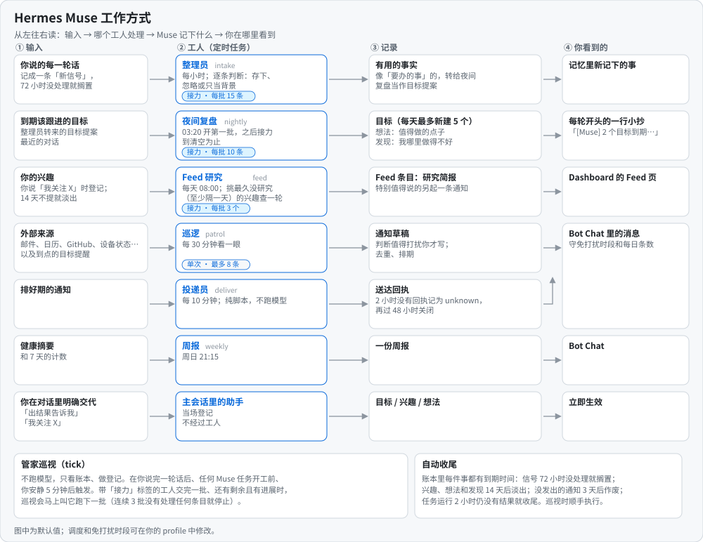

# Hermes Muse 0.4.4

[English](README.md) · [设计文档](docs/DESIGN.md) · [接口](skills/companion/references/interface.md) · [验收清单](docs/ACCEPTANCE.md) · [更新日志](CHANGELOG.md)

只在你开口时才回答的助手，会漏掉很多事：周一提过的出行、在等的回复、说好月底前做的决定。Hermes Muse 是 [Hermes Agent](https://github.com/NousResearch/hermes-agent) 的插件，让 Hermes 自己跟进这些事。灵感来自 [Meta Muse](https://about.fb.com/news/2026/09/introducing-muse-personal-ai-agent/) 的主动交互。

实际效果：

- 你说月底前要选好一辆自行车。Muse 把它记成目标，定期跟进，只有你说定了才关闭。
- 你在等的回复到了，或者会议改了时间。下一轮 patrol 用你的工具读原始邮件或日程，告诉你发生了什么、为什么重要，而且只说一次。
- “做完了”“晚点再说”“别再提这个”各有不同处理。没有值得说的就保持安静，遵守静默时段，同一条通知不会重复。
- 你不再提起的目标，会先被问一次再关闭，而不是一直被追。

它基于 Hermes 已有的会话、cron、投递、委派和原生 memory，沿用你现有的模型和 memory provider。本项目独立开发，与 Meta/Muse 无关，代码和提示词均为独立编写。

**0.4.0 即 Muse v2**：确定性内核负责记账（水位、去重、状态机、投递），模型只做判断和写作，独立的 Health 检查让故障可见。从 0.3.x 升级是自动的，请先读[升级说明](CHANGELOG.md)。

## 插件页面

Muse 的 Dashboard 与 Desktop 页面可选择 profile，浏览它的 Feed、Ideas 和 Goals，顶部显示最近一次健康检查。页面只读，跟随宿主主题。


*选择 profile，浏览或搜索 Feed 文章，切换到 Ideas 或 Goals。截图均为演示数据。*


*打开 Feed 文章阅读 Markdown 正文，下方列出来源。*


*Ideas 按相关目标分组。*


*Goals 先列开放目标，显示状态、下次检查和最新进展；已完成和已取消的折叠在下方。*

## 安装

```sh
hermes plugins install xiaohei-info/hermes-muse --enable
```

安装作用于所选 profile（`hermes -p <profile> plugins install …`），每个启用的 profile 有独立的状态、job 和投递。如果你维护了显式的 `platform_toolsets` 列表，请在使用的平台里加上 `muse`。

需要 Hermes 0.21.5 及以上，并具备工具、Skill、提示词段和 hooks 的插件接口；已在 Hermes 0.22.5 上测试（[基线](docs/ACCEPTANCE.md)）。首次加载注册 1 个 Skill、2 个工具（`muse_manage`、`muse_job`）、4 个 hooks 和 1 段系统提示词，创建 5 个周期 job 和 `muse-health` 检查，并从 `templates/` 补齐缺失的内容文件，不覆盖已有文件。新开会话后提示词段生效；后台工作需要运行中的调度器和可用模型，按正常用量计费。

### 版本要求

- Hermes Agent 0.21.5 及以上（`plugin.yaml` 中 `requires_hermes: ">=0.21.5"`）。Hermes 本身需要 Python 3.14。
- 仅在 Hermes 0.22.5 上测试过：CI 固定该版本并跑完整验收。
- 其他版本不按版本号判断。三项核心能力（prompt section、插件 skill、卸载钩子）是硬性要求，缺失时 Muse 拒绝加载并给出明确错误；其他能力由宿主探测检查，缺失只降级对应功能，并在 Health 显示一条 high 项。升级 Hermes 后请运行 `tests/native_host_contract.py`（[详情](docs/ACCEPTANCE.md)）。

**从 0.3.x 升级**（目录里的 0.3.1 或之后任一 0.3 版本）：首次加载把 `muse/state.db` 迁移到 `muse/state-v2.db`，并原地刷新 job，保留 job ID、调度、路由和暂停状态。先改写调用了已删除动作的个人 cron prompt 或脚本（[调用方迁移](docs/CALLER-MIGRATION.md)），按[切换与回滚](docs/CUTOVER.md)逐步切换或回到 0.3.x。

## 工作方式

每个定时任务把一类输入变成 Muse 记下的内容，你在消息、Dashboard 页面或下一次对话里看到结果。下图为默认设置。



| job（cron key） | 默认调度 | 模型做什么 | 投递 |
|---|---|---|---|
| intake（`memory-upkeep`） | 每小时，分批处理完为止 | 判断每条新私聊消息的含义和相关目标 | local |
| patrol（`proactive-watch`） | 每 30 分钟 | 用你的工具读来源，判断什么值得通知并写出通知 | 你的路由 |
| nightly（`nightly-review`） | 03:20 | 评估全部到期目标、判断全部复盘候选、写 dream 和 alignment | local |
| feed（`feed-pulse`） | 08:00 | 每个 active interest 每天研究一次，写 Feed 文章，有真正的新进展时可发一条通知 | 静默；通知走通知门控 |
| weekly（`weekly-governance-review`） | 周日 21:15 | 根据 Health 摘要和 7 天计数写一条周报 | 你的路由 |
| deliver（`deliver`） | 每 10 分钟 | 不调用模型。把到期的通知合成一条消息发出（urgent 会立即唤醒它） | 你的路由 |

每个 job 的 launcher 先运行内核、组装有界 packet；intake、nightly 和 feed 的 packet 为空时不唤醒模型；nightly 和 feed 分批处理队列，Muse 会接着唤醒它们直到处理完；patrol 每轮都唤醒，因为只有模型能读你的来源。代码负责捕获消息、派生所有 ID 和键、对 7 天历史去重、执行静默时段和预算、投递、读投递回执、推进下次检查、询问并关闭休眠目标。模型只返回引用、枚举值和文本。行为写在 `prompts/jobs/<job>.md`，字段见生成的[接口](skills/companion/references/interface.md)。详见[设计文档](docs/DESIGN.md)和[功能覆盖](docs/FEATURE-COVERAGE.zh-CN.md)。

只有用户界面上的私聊（CLI、TUI、桌面、手机和 `USER_SOURCES` 列出的消息平台私信）会被读取，也只有它们能修改 Muse 状态。cron run、委派子代理、群聊和未分类来源都不能。

## 数据源

Muse 不带连接器。patrol 只通过你的 Hermes 已有的工具读邮件、日历、提醒和网页：先用 Hermes 内置（`web_search`/`web_extract`、`google-workspace`、`himalaya`、`apple-reminders`、`imessage`、`apple-notes`），再用 [Apple PIM](skills/companion/references/source-apple-pim.md)，个人来源记在 profile 的 `muse/TOOLS.md`（[来源说明](skills/companion/references/sources.md)）。每次检查按来源记录，并有最小检查间隔；未连接或持续失败的来源会出现在 Health 中。安装后按[来源校验](skills/companion/references/source-verification.md)逐个确认。

## 偏好

在对话里说，或编辑 `muse/PROACTIVE_PREFERENCES.md`。字段：`start_hour`/`end_hour`（之外为静默时段，默认 9–22）、`ordinary_per_day`（默认不限）、`time_sensitive_per_day`（默认 3）、`urgent_per_day`（可越过静默时段的 urgent 通知数，默认 2，超出按 time_sensitive 处理）、`blocked_topics`、`deliver`（发送通知的 `muse-deliver` job 的路由，默认本 profile 的 Bot Chat；修改从它的下一轮起生效，`null` 保留 job 现有路由）、`goal_dormant_days` 与 `goal_fade_days`（默认各 7，`null` 关闭）、`fade_question`、`weather_context`（默认关闭，会用到你给过的地点）。偏好无效时停止投递并报错，不猜默认值。

## Hermes 配置

下表列出当前 profile 的 Hermes `config.yaml` 中 Muse 会读取或依赖的配置。静默时段、每日预算、`blocked_topics` 和通知路由在 Muse 自己的 `muse/PROACTIVE_PREFERENCES.md` 里设置（见“偏好”），不在这里。

| 配置 | 建议值 | 原因 / 不这样设会怎样 |
|---|---|---|
| `plugins.enabled` 包含 `hermes-muse`（且不在 `plugins.disabled` 中） | 启用 | 每个 Muse job 的 launcher 先检查这一项。未启用或配置读取失败时，所有 job 都保持静默。 |
| `plugins.entries.hermes-muse.settings` | Muse 插件设置都放这里 | 优先于 `.config` 和旧位置 `plugins.hermes-muse`。旧位置还有设置时，Health 报 `probe.config_location` degraded，直到迁走为止。 |
| ↳ `deliver` | 不设（回退到本 profile 的 Bot Chat） | 偏好里没设 `deliver` 时使用：`muse-deliver`（通知）、patrol/weekly/watch job 和 `muse-health` 的路由。job 在创建时取路由，之后刷新保留 job 现有的路由。 |
| ↳ `health_deliver` | 可选的第二路由 | 安装时追加到 `muse-health` job 的路由上，告警集合变化时 Health 告警也发到这里。不设时，告警只出现在主会话、Muse 页面和 cron 输出里。之后删掉这个设置不会移除路由，需要自己改 job 的投递目标。 |
| ↳ `source_intervals` | 不设（内置：mail 30 分钟、calendar 2 小时、reminders 1 小时、web/rss 6 小时） | `{来源 id 或类型: 分钟}`，决定 patrol 多久重查一次某个来源。间隔越短，模型开销越大。 |
| `platform_toolsets`（仅在你维护显式列表时） | 包含 `muse` | `muse_manage`/`muse_job` 注册在 toolset `muse` 下。列表里缺了它，这两个工具就不可见：job 无法 submit，会话里也无法管理目标。 |
| `timezone`（或 `HERMES_TIMEZONE`） | 你的 IANA 时区 | 静默时段、每日预算、每日建目标上限和默认调度都按 Hermes 的 profile 时间计算。不设时使用服务器本地时间。 |
| `memory.write_approval` | `false`（默认） | 设为 `true` 后，因为 cron 会话里没人能批准，所有记忆写入（包括新增）都会被暂存待批，intake 就永远存不下任何事实。intake 的写入由 Muse 自己把关（见下一行）。 |
| `memory.memory_enabled` / `memory.user_profile_enabled` | `true`（默认） | intake 用原生 `memory` 工具保存事实，被关闭的 store 会拒绝写入。 |
| `memory.memory_char_limit` / `memory.user_char_limit` | 默认或更大 | 用量 ≥90% 时，intake 可以在保存新事实的同一个原生 batch 里合并重复条目或缩短冗长条目，但不会直接删除任何条目（Muse 会拒绝这种调用）。每处改动都写进当天的 Muse 笔记，并列在 nightly 的 dream 里，方便你恢复。≥98% 时 Health 报 `memory_capacity`。不想被压缩条目就调大上限。 |
| Bot Chat 会话的 `cwd` | 本机上存在的目录 | 该会话的 cwd 不存在时，Hermes 拒绝向 Bot Chat 投递（`invalid_params field=cwd`），Health 报 `probe.delivery_target` missing。不要靠改 `terminal.cwd` 来修。 |
| gateway / cron 调度器 | 保持运行 | Muse 的所有 job 和 `muse-health` 都是 Hermes cron。调度器不跑就什么都不会执行，Health 会报 `jobs_late`。 |

## 健康检查

`muse-health` 每 30 分钟运行一次，不调用模型，写出 `muse/health.json`：宿主 probe 加上对信号、packet、通知、投递、run、目标和来源的不变量检查，每项带级别和修复方法。high 项会出现在你下一次私聊和 Muse 页面上；告警集合变化时 cron 会输出；插件设置 `health_deliver`（在 `plugins.entries.hermes-muse.settings` 下）会作为该 job 的第二条路由。Health 不经过通知管道，也不修复任何东西。可以问“Muse 健康吗？”，或用 `muse_manage read(kind=status)`。

## 使用

在私聊里正常说话，例如：

```text
建一个买自行车的目标：预算 1000 美元，月底前决定。
帮我盯着这条消息的回复，到周五为止。
我关注太空探索，有重要进展可以告诉我，不需要每日简报。
这个提醒做完了。/ 别再提醒这个话题。
看看我未来 30 天的日程。
列出我的目标、兴趣和待发通知。
忘掉我说过的搬家的事。
```

目标需要你明确的计划或承诺；随口提到的兴趣 14 天后过期，除非你再提起。可以问查过什么、哪里失败、还有什么没完成；助手会读 Muse 状态，而不是猜。

## 文件

`<profile home>/muse/` 下：`state-v2.db`（Store v2，只有内核写）、`health.json`、`workspace/goals/<slug>/GOAL.md`（目标事实源）、`memory/`、`dreams/`、`memory/people|groups/`、`workspace/your_files/feed/*.md`、`AGENTS.md`、`TOOLS.md`、`PROACTIVE_PREFERENCES.md`；升级后还有只读的 `state.db` 和 `backup/cron-prompts-0.3.json`。launcher 是 `<profile home>/scripts/hermes-muse-*.py`。Muse 从不修改 SOUL、`memories/`、`cron/jobs.json` 和 Hermes 的数据库。留存说明见[兼容与留存](docs/CATALOG-COMPATIBILITY.md#retention)和 [SECURITY.md](SECURITY.md)。

## 卸载

在私聊里说要卸载 Muse。助手会运行 `installation_prepare`，和你确认后暂停所有 Muse job（`preferences pause_jobs=true`），然后执行：

```sh
hermes plugins remove hermes-muse
```

插件停用或删除后，launcher 保持静默。数据留在 `<profile home>/muse/`，重新安装后会继续使用。

## 开发与验证

```sh
export TMPDIR=$(mktemp -d) HERMES_HOME=$(mktemp -d)
python scripts/check_boundaries.py
python scripts/check_callers.py prompts templates skills after-install.md
PYTHONPATH=<hermes-agent> <hermes python> tests/kernel_acceptance.py   # 以及其他 tests/*_acceptance.py
```

完整清单及哪些可在无 Hermes 环境运行，见 [ACCEPTANCE.md](docs/ACCEPTANCE.md)；贡献规则见 [AGENTS.md](AGENTS.md)。测试使用临时 profile 和合成数据，不调用模型，也不真实投递。

Muse 已收录在 Hermes 官方插件目录：`hermes plugins install hermes-muse` 安装目录里钉住的审核版本，可能落后于本仓库。

MIT 许可。
